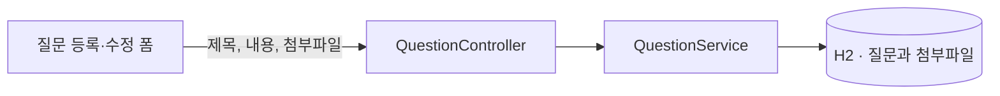

# 질문에 파일 첨부 기능 추가하기

기존 질문 등록·수정 화면에서 파일을 첨부하고, 질문 상세에서 내려받는 실습입니다. 게시글을 수정할 때 기존 파일을 개별 삭제할 수 있으며, 질문을 삭제하면 해당 질문의 첨부도 함께 삭제됩니다. 각 단계의 경로와 붙여넣을 위치를 확인한 뒤 순서대로 진행하세요.

## 시작하기 전에

이 문서는 현재 `board/` 모듈의 Spring MVC, Thymeleaf, Spring Data JPA, H2 구성을 기준으로 합니다. `build.gradle`에서 Java 25를 사용하고 있으므로 IDE와 터미널이 같은 JDK를 쓰는지 `java -version`으로 확인하세요. 기존 의존성으로 실습할 수 있습니다. 현재 DB에 중요한 게시글이 있다면 앱을 종료한 뒤 `board/local.mv.db`를 복사해 두세요. 1~5단계의 코드가 서로 연결되므로, 모두 적용한 뒤 6단계에서 실행합니다. [빌드 설정](../board/build.gradle) · [DB 설정](../board/src/main/resources/application.properties)

| 항목 | 이 실습에서 적용하는 규칙 |
| --- | --- |
| 파일 개수 | 질문당 0~3개. 수정 시 기존 파일과 새 파일을 합산합니다. |
| 파일 크기 | 파일당 최대 1MB, 요청 전체 최대 4MB |
| 허용 확장자 | `.pdf`, `.png`, `.jpg`, `.jpeg`, `.txt` |
| 권한 | 등록은 로그인 사용자, 수정과 삭제는 작성자, 다운로드는 질문 상세와 같이 누구나 가능 |
| 저장 위치 | 기존 H2 DB의 `question_attachment` 테이블 |

질문 한 건에 첨부파일 여러 건이 연결되는 **1:N 관계**입니다. 첨부 테이블의 각 행에는 질문 ID, 표시할 파일명, 파일 내용이 들어갑니다. 파일 내용은 작은 실습용 파일을 대상으로 H2의 BLOB에 저장합니다. 질문과 파일이 같은 DB에 있어 제목 수정, 파일 추가, 파일 삭제가 전부 성공해야 변경이 확정됩니다. 오류가 생기면 한 번의 저장 시도에서 수행한 변경을 함께 되돌릴 수 있습니다. 첨부가 없는 기존 질문은 이 테이블에 연결된 행이 0개입니다.



## 1. 업로드 용량 제한 설정하기

`board/src/main/resources/application.properties` 파일 맨 아래에 추가합니다. 기존 마지막 줄 다음에 줄바꿈을 넣고 붙여넣으세요. 요청 전체 한도에는 제목, 본문, 폼 데이터의 구분 정보도 포함됩니다. [Spring Boot multipart 설정](https://docs.spring.io/spring-boot/api/java/org/springframework/boot/servlet/autoconfigure/MultipartProperties.html)

```properties
spring.servlet.multipart.max-file-size=1MB
spring.servlet.multipart.max-request-size=4MB
```

## 2. 첨부파일 엔티티와 조회 메서드 만들기

### 2.1 `QuestionAttachment.java` 새로 만들기

`board/src/main/java/com/board/question/QuestionAttachment.java`를 만들고 아래 전체를 붙여넣습니다. `question_id`는 이 파일이 속한 질문을 가리키며, `@Lob`은 파일의 바이트 배열을 DB에 저장할 때 사용합니다.

```java
package com.board.question;

import jakarta.persistence.Column;
import jakarta.persistence.Entity;
import jakarta.persistence.FetchType;
import jakarta.persistence.GeneratedValue;
import jakarta.persistence.GenerationType;
import jakarta.persistence.Id;
import jakarta.persistence.JoinColumn;
import jakarta.persistence.Lob;
import jakarta.persistence.ManyToOne;
import jakarta.persistence.Table;
import lombok.Getter;

@Getter
@Entity
@Table(name = "question_attachment")
public class QuestionAttachment {
    @Id
    @GeneratedValue(strategy = GenerationType.IDENTITY)
    private Integer id;

    @ManyToOne(fetch = FetchType.LAZY, optional = false)
    @JoinColumn(name = "question_id", nullable = false)
    private Question question;

    @Column(nullable = false, length = 200)
    private String originalFilename;

    @Lob
    @Column(nullable = false)
    private byte[] content;

    protected QuestionAttachment() {
    }

    QuestionAttachment(Question question, String originalFilename, byte[] content) {
        this.question = question;
        this.originalFilename = originalFilename;
        this.content = content;
    }
}
```

### 2.2 `Question.java`에 관계 추가하기

`board/src/main/java/com/board/question/Question.java`의 import 부분에 아래 한 줄을 추가합니다.

```java
import java.util.ArrayList;
```

같은 파일에서 `answerList` 필드 바로 아래에 다음 코드를 붙여넣습니다.

```java
    @OneToMany(mappedBy = "question", cascade = CascadeType.ALL, orphanRemoval = true)
    private List<QuestionAttachment> attachments = new ArrayList<>();

    void addAttachment(String filename, byte[] content) {
        this.attachments.add(new QuestionAttachment(this, filename, content));
    }
```

`cascade` 덕분에 질문을 새로 저장하거나 삭제할 때 연결된 파일도 함께 처리됩니다. `orphanRemoval`은 수정 중 목록에서 뺀 파일의 DB 행을 삭제합니다.

### 2.3 `QuestionAttachmentRepository.java` 새로 만들기

`board/src/main/java/com/board/question/QuestionAttachmentRepository.java`를 만들고 아래 전체를 붙여넣습니다. 화면에 파일명을 표시할 때는 `Summary`에 정의된 두 값만 조회합니다. 다운로드 요청은 질문 ID와 첨부 ID가 모두 일치하는 행을 찾아 파일 내용을 읽습니다.

```java
package com.board.question;

import java.util.List;
import java.util.Optional;

import org.springframework.data.jpa.repository.JpaRepository;

public interface QuestionAttachmentRepository extends JpaRepository<QuestionAttachment, Integer> {
    List<Summary> findByQuestion_IdOrderByIdAsc(Integer questionId);

    Optional<QuestionAttachment> findByQuestion_IdAndId(Integer questionId, Integer attachmentId);

    interface Summary {
        Integer getId();

        String getOriginalFilename();
    }
}
```

### 2.4 `QuestionRepository.java`에 수정·삭제용 조회 추가하기

`board/src/main/java/com/board/question/QuestionRepository.java`의 import 부분에 추가합니다.

```java
import java.util.Optional;

import org.springframework.data.jpa.repository.Lock;
import org.springframework.data.jpa.repository.Query;
import org.springframework.data.repository.query.Param;

import jakarta.persistence.LockModeType;
```

같은 파일에서 인터페이스의 마지막 `}` 바로 위에 추가합니다. 이 조회는 같은 질문을 두 탭에서 동시에 수정하거나 삭제할 때, 한 요청이 처리를 마친 뒤 다음 요청이 최신 첨부 목록을 확인하게 합니다.

```java
    @Lock(LockModeType.PESSIMISTIC_WRITE)
    @Query("select q from Question q where q.id = :id")
    Optional<Question> findForUpdate(@Param("id") Integer id);
```

## 3. 폼과 서비스 연결하기

### 3.1 `QuestionForm.java` 전체 교체하기

`board/src/main/java/com/board/question/QuestionForm.java`를 아래 내용으로 교체합니다. `files`는 새로 올릴 파일 목록, `removeAttachmentIds`는 수정 화면에서 삭제를 선택한 첨부 ID 목록입니다. 제목과 본문 검증은 지금과 같습니다. [Spring MVC에서 파일을 폼 객체에 바인딩하는 방법](https://docs.spring.io/spring-framework/reference/web/webmvc/mvc-controller/ann-methods/multipart-forms.html)

```java
package com.board.question;

import java.util.ArrayList;
import java.util.List;

import org.springframework.web.multipart.MultipartFile;

import jakarta.validation.constraints.NotEmpty;
import jakarta.validation.constraints.Size;
import lombok.Getter;
import lombok.Setter;

@Getter
@Setter
public class QuestionForm {
    @NotEmpty(message = "제목은 필수항목입니다.")
    @Size(max = 200)
    private String subject;

    @NotEmpty(message = "내용은 필수항목입니다.")
    private String content;

    private List<MultipartFile> files = new ArrayList<>();
    private List<Integer> removeAttachmentIds = new ArrayList<>();
}
```

### 3.2 `QuestionService.java`에 저장·수정·삭제 로직 추가하기

`board/src/main/java/com/board/question/QuestionService.java`의 import 부분에 추가합니다.

```java
import java.io.IOException;
import java.io.UncheckedIOException;
import java.util.HashSet;
import java.util.Locale;
import java.util.Set;
import java.util.stream.Collectors;

import org.springframework.http.HttpStatus;
import org.springframework.transaction.annotation.Transactional;
import org.springframework.util.StringUtils;
import org.springframework.web.multipart.MultipartFile;
import org.springframework.web.server.ResponseStatusException;
```

기존 `private final QuestionRepository questionRepository;` 바로 아래에 추가합니다.

```java
    private final QuestionAttachmentRepository attachmentRepository;

    private static final int MAX_ATTACHMENTS = 3;
    private static final Set<String> ALLOWED_EXTENSIONS = Set.of("pdf", "png", "jpg", "jpeg", "txt");
```

기존 `create(String subject, String content, SiteUser user)` 메서드 하나를 아래 두 메서드로 교체합니다. 세 인자를 받는 메서드는 기존 테스트에서도 호출합니다.

```java
    @Transactional
    public void create(String subject, String content, SiteUser user) {
        create(subject, content, user, List.of());
    }

    @Transactional
    public void create(String subject, String content, SiteUser user, List<MultipartFile> files) {
        List<MultipartFile> uploads = getSelectedFiles(files);
        checkAttachmentCount(uploads.size());

        Question question = new Question();
        question.setSubject(subject);
        question.setContent(content);
        question.setCreateDate(LocalDateTime.now());
        question.setAuthor(user);
        addAttachments(question, uploads);
        this.questionRepository.save(question);
    }
```

기존 `modify(...)`와 `delete(...)` 메서드를 아래 블록으로 교체합니다. 기존 추천과 검색 메서드는 이 블록 뒤에 이어집니다.

```java
    @Transactional
    public void modify(Integer id, QuestionForm form, String username) {
        Question question = getQuestionForUpdate(id, username);
        List<QuestionAttachment> attachments = question.getAttachments();
        Set<Integer> removalIds = new HashSet<>(form.getRemoveAttachmentIds());
        Set<Integer> existingIds = attachments.stream()
                .map(QuestionAttachment::getId)
                .collect(Collectors.toSet());

        if (!existingIds.containsAll(removalIds)) {
            throw new AttachmentValidationException("첨부 목록이 변경됐습니다. 목록을 확인하고 다시 저장해 주세요.");
        }

        List<MultipartFile> uploads = getSelectedFiles(form.getFiles());
        checkAttachmentCount(attachments.size() - removalIds.size() + uploads.size());

        attachments.removeIf(attachment -> removalIds.contains(attachment.getId()));
        addAttachments(question, uploads);
        question.setSubject(form.getSubject());
        question.setContent(form.getContent());
        question.setModifyDate(LocalDateTime.now());
    }

    @Transactional
    public void delete(Integer id, String username) {
        Question question = getQuestionForUpdate(id, username);
        this.questionRepository.delete(question);
    }

    public Question getEditableQuestion(Integer id, String username) {
        Question question = getQuestion(id);
        checkAuthor(question, username);
        return question;
    }

    public List<QuestionAttachmentRepository.Summary> getAttachments(Integer questionId) {
        return this.attachmentRepository.findByQuestion_IdOrderByIdAsc(questionId);
    }

    @Transactional(readOnly = true)
    public QuestionAttachment getAttachment(Integer questionId, Integer attachmentId) {
        return this.attachmentRepository.findByQuestion_IdAndId(questionId, attachmentId)
                .orElseThrow(() -> new DataNotFoundException("attachment not found"));
    }

    private Question getQuestionForUpdate(Integer id, String username) {
        Question question = this.questionRepository.findForUpdate(id)
                .orElseThrow(() -> new DataNotFoundException("question not found"));
        checkAuthor(question, username);
        return question;
    }

    private void checkAuthor(Question question, String username) {
        if (question.getAuthor() == null || !question.getAuthor().getUsername().equals(username)) {
            throw new ResponseStatusException(HttpStatus.FORBIDDEN, "질문 작성자만 변경할 수 있습니다.");
        }
    }

    private List<MultipartFile> getSelectedFiles(List<MultipartFile> files) {
        return files.stream()
                .filter(file -> !file.isEmpty() || StringUtils.hasText(file.getOriginalFilename()))
                .toList();
    }

    private void checkAttachmentCount(int count) {
        if (count > MAX_ATTACHMENTS) {
            throw new AttachmentValidationException("질문당 파일은 최대 3개까지 첨부할 수 있습니다.");
        }
    }

    private void addAttachments(Question question, List<MultipartFile> files) {
        for (MultipartFile file : files) {
            if (file.isEmpty()) {
                throw new AttachmentValidationException("내용이 비어 있는 파일은 첨부할 수 없습니다.");
            }

            String originalFilename = file.getOriginalFilename();
            String filename = originalFilename == null
                    ? "" : StringUtils.getFilename(originalFilename.replace('\\', '/')).strip();
            if (filename.isBlank() || filename.length() > 200
                    || filename.codePoints().anyMatch(Character::isISOControl)) {
                throw new AttachmentValidationException("파일 이름을 확인해 주세요. 최대 200자까지 사용할 수 있습니다.");
            }

            int dot = filename.lastIndexOf('.');
            String extension = dot > 0 ? filename.substring(dot + 1).toLowerCase(Locale.ROOT) : "";
            if (!ALLOWED_EXTENSIONS.contains(extension)) {
                throw new AttachmentValidationException("PDF, PNG, JPG, JPEG, TXT 파일만 첨부할 수 있습니다.");
            }

            try {
                question.addAttachment(filename, file.getBytes());
            } catch (IOException e) {
                throw new UncheckedIOException("첨부파일을 읽을 수 없습니다.", e);
            }
        }
    }

    public static class AttachmentValidationException extends RuntimeException {
        AttachmentValidationException(String message) {
            super(message);
        }
    }
```

수정은 작성자 확인, 삭제할 첨부 ID 확인, 개수 확인, 저장 순으로 진행됩니다. 예를 들어 파일 3개 중 1개를 삭제하고 1개를 추가하면 저장 후에도 3개입니다. 제목이나 본문만 수정하면 기존 첨부는 그대로 남습니다. `@Transactional` 안에서 조회한 질문은 JPA가 관리하므로, 수정 메서드가 정상적으로 끝나면 제목·본문과 첨부 목록 변경이 함께 반영됩니다.

## 4. 컨트롤러에서 폼과 다운로드 처리하기

### 4.1 `QuestionController.java` 수정하기

`board/src/main/java/com/board/question/QuestionController.java`의 import 부분에 추가합니다.

```java
import java.nio.charset.StandardCharsets;

import org.springframework.http.ContentDisposition;
import org.springframework.http.HttpHeaders;
import org.springframework.http.MediaType;
import org.springframework.http.ResponseEntity;
```

`detail(...)`에서 `return "question_detail";` 바로 위에 추가합니다.

```java
        model.addAttribute("attachments", this.questionService.getAttachments(id));
```

`@PostMapping("/create")`가 붙은 기존 등록 메서드를 아래 코드로 교체합니다. `@GetMapping("/create")`가 붙은 메서드는 등록 화면을 여는 데 계속 사용됩니다.

```java
    @PreAuthorize("isAuthenticated()")
    @PostMapping("/create")
    public String questionCreate(@Valid QuestionForm questionForm, BindingResult bindingResult, Principal principal) {
        if (bindingResult.hasErrors()) {
            return "question_form";
        }

        SiteUser siteUser = this.userService.getUser(principal.getName());
        try {
            this.questionService.create(questionForm.getSubject(), questionForm.getContent(),
                    siteUser, questionForm.getFiles());
        } catch (QuestionService.AttachmentValidationException e) {
            bindingResult.reject("attachment.invalid", e.getMessage());
            return "question_form";
        }
        return "redirect:/question/list";
    }
```

기존 수정 GET, 수정 POST, 삭제 GET 메서드를 아래 블록으로 교체합니다. 첫 주석에는 작성자 확인과 기존 값으로 폼을 채우는 역할을 새 코드에 맞춰 설명했습니다. 아래 삭제 메서드는 **POST**로 받으며 5단계에서 삭제 버튼을 그에 맞게 연결합니다.

```java
    // 작성자인지 확인한 뒤 기존 제목, 본문, 첨부 목록을 수정 화면에 전달합니다.
    @PreAuthorize("isAuthenticated()")
    @GetMapping("/modify/{id}")
    public String questionModify(Model model, QuestionForm questionForm, @PathVariable("id") Integer id,
            Principal principal) {
        Question question = this.questionService.getEditableQuestion(id, principal.getName());
        questionForm.setSubject(question.getSubject());
        questionForm.setContent(question.getContent());
        addModifyAttributes(model, id);
        return "question_form";
    }

    @PreAuthorize("isAuthenticated()")
    @PostMapping("/modify/{id}")
    public String questionModify(Model model, @Valid QuestionForm questionForm, BindingResult bindingResult,
            Principal principal, @PathVariable("id") Integer id) {
        if (bindingResult.hasErrors()) {
            this.questionService.getEditableQuestion(id, principal.getName());
            addModifyAttributes(model, id);
            return "question_form";
        }

        try {
            this.questionService.modify(id, questionForm, principal.getName());
        } catch (QuestionService.AttachmentValidationException e) {
            bindingResult.reject("attachment.invalid", e.getMessage());
            addModifyAttributes(model, id);
            return "question_form";
        }
        return "redirect:/question/detail/" + id;
    }

    @PreAuthorize("isAuthenticated()")
    @PostMapping("/delete/{id}")
    public String questionDelete(Principal principal, @PathVariable("id") Integer id) {
        this.questionService.delete(id, principal.getName());
        return "redirect:/";
    }

    @GetMapping("/{id}/attachments/{attachmentId}")
    public ResponseEntity<byte[]> downloadAttachment(@PathVariable("id") Integer id,
            @PathVariable("attachmentId") Integer attachmentId) {
        QuestionAttachment attachment = this.questionService.getAttachment(id, attachmentId);
        String disposition = ContentDisposition.attachment()
                .filename(attachment.getOriginalFilename(), StandardCharsets.UTF_8)
                .build()
                .toString();

        return ResponseEntity.ok()
                .contentType(MediaType.APPLICATION_OCTET_STREAM)
                .header(HttpHeaders.CONTENT_DISPOSITION, disposition)
                .header("X-Content-Type-Options", "nosniff")
                .body(attachment.getContent());
    }

    private void addModifyAttributes(Model model, Integer id) {
        model.addAttribute("questionId", id);
        model.addAttribute("attachments", this.questionService.getAttachments(id));
    }
```

다운로드 응답은 UTF-8 파일명을 전달하고 브라우저에 첨부파일로 저장하도록 안내합니다. URL의 질문 ID와 첨부 ID가 실제로 연결된 경우에만 내려받을 수 있습니다. 수정과 삭제는 화면의 버튼 표시 여부와 관계없이 서버에서 작성자 권한을 확인합니다.

### 4.2 `AnswerController.java`에서 답변 검증 실패 처리 보완하기

`board/src/main/java/com/board/answer/AnswerController.java`의 `createAnswer(...)`에서 `if (bindingResult.hasErrors())` 블록 안의 `return "question_detail";` 바로 위에 추가합니다. 답변을 비워 제출할 때도 같은 상세 템플릿을 사용하므로, 이 경로에서도 첨부 목록이 필요합니다. [기존 상세 화면의 렌더링 경로](question-detail-markdown-rendering.md)

```java
            model.addAttribute("attachments", this.questionService.getAttachments(id));
```

## 5. 화면에 업로드와 다운로드 추가하기

### 5.1 `question_form.html` 전체 교체하기

`board/src/main/resources/templates/question_form.html`을 아래 내용으로 교체합니다. 폼의 `enctype`은 제목과 본문에 파일 데이터까지 포함해 전송하게 합니다. 기존 폼처럼 현재 화면의 주소로 POST하므로 등록과 수정에 같은 폼을 쓸 수 있습니다. CSRF 숨은 필드는 로그인 세션을 이용하는 폼 제출을 보호합니다. 수정 화면에서는 체크한 첨부가 **저장하기**를 눌렀을 때 삭제됩니다. [Spring Security의 multipart 폼과 CSRF](https://docs.spring.io/spring-security/reference/servlet/exploits/csrf.html#csrf-considerations-multipart)

```html
<html layout:decorate="~{layout}">
<div layout:fragment="content" class="container">
    <h5 class="my-3 border-bottom pb-2"
        th:text="${questionId != null ? '질문 수정' : '질문 등록'}"></h5>
    <form th:object="${questionForm}" method="post" enctype="multipart/form-data">
        <input type="hidden" th:name="${_csrf.parameterName}" th:value="${_csrf.token}" />
        <div th:replace="~{form_errors :: formErrorsFragment}"></div>

        <div class="mb-3">
            <label for="subject" class="form-label">제목</label>
            <input type="text" th:field="*{subject}" class="form-control">
        </div>
        <div class="mb-3">
            <label for="content" class="form-label">내용</label>
            <textarea th:field="*{content}" class="form-control" rows="10"></textarea>
        </div>

        <fieldset class="mb-3" th:if="${attachments != null and !attachments.isEmpty()}">
            <legend class="form-label fs-6">기존 첨부파일</legend>
            <div class="form-check" th:each="attachment : ${attachments}">
                <input class="form-check-input" type="checkbox" name="removeAttachmentIds"
                       th:id="|remove-attachment-${attachment.id}|" th:value="${attachment.id}"
                       th:checked="${questionForm.removeAttachmentIds.contains(attachment.id)}">
                <label class="form-check-label" th:for="|remove-attachment-${attachment.id}|"
                       th:text="|${attachment.originalFilename} 삭제|"></label>
            </div>
        </fieldset>

        <div class="mb-3">
            <label for="files" class="form-label">첨부파일</label>
            <input type="file" id="files" name="files" class="form-control" multiple
                   accept=".pdf,.png,.jpg,.jpeg,.txt" aria-describedby="attachment-help">
            <div id="attachment-help" class="form-text">
                기존 파일 포함 최대 3개, 파일당 1MB. PDF, PNG, JPG, JPEG, TXT를 첨부할 수 있습니다.
            </div>
        </div>
        <input type="submit" value="저장하기" class="btn btn-primary my-2">
    </form>
</div>
</html>
```

`accept`는 파일 선택 창에 표시할 파일 형식의 힌트입니다. 실제 확장자 검사는 서버에서 수행합니다. 제목이나 첨부 검증에 실패해 폼이 다시 열리면 브라우저가 파일 선택을 비우므로, 새 파일을 다시 선택한 뒤 저장하세요.

### 5.2 `question_detail.html`에 다운로드 링크와 삭제 폼 추가하기

`board/src/main/resources/templates/question_detail.html`에서 질문 본문을 출력하는 `th:utext="${questionHtml}"` 줄 바로 아래에 추가합니다. 질문 본문 영역 안에서, 답변 반복문보다 위에 넣습니다. 파일명이 HTML로 해석되지 않도록 `th:text`로 표시합니다.

```html
            <section class="mt-3" th:if="${!attachments.isEmpty()}">
                <h3 class="h6">첨부파일</h3>
                <ul class="mb-2">
                    <li th:each="attachment : ${attachments}">
                        <a th:href="@{/question/{id}/attachments/{attachmentId}
                            (id=${question.id}, attachmentId=${attachment.id})}"
                           th:text="${attachment.originalFilename}"></a>
                    </li>
                </ul>
            </section>
```

같은 파일에서 `/question/delete/`를 가리키는 기존 질문 삭제 링크(`<a ...>...</a>`) 한 개를 아래 폼으로 교체합니다. `th:action`과 POST 방식의 폼을 쓰면 Spring Security와 통합된 Thymeleaf가 숨은 CSRF 필드를 생성합니다. 아래쪽 `/answer/delete/` 링크는 답변 삭제용입니다.

```html
                <form th:action="@{/question/delete/{id}(id=${question.id})}" method="post"
                      class="d-inline" sec:authorize="isAuthenticated()"
                      th:if="${question.author != null and #authentication.name == question.author.username}"
                      onsubmit="return confirm('정말로 삭제하시겠습니까?');">
                    <button type="submit" class="btn btn-outline-secondary btn-sm">삭제</button>
                </form>
```

## 6. 실행하고 확인하기

저장소 루트에서 다음 명령을 실행합니다. 앱이 시작되면 기존 `spring.jpa.hibernate.ddl-auto=update` 설정에 따라 H2에 첨부파일 테이블이 추가됩니다.

```bash
cd board
bash ./gradlew bootRun
```

Windows PowerShell에서는 `board` 폴더로 이동한 뒤 `.\gradlew.bat bootRun`을 실행하면 됩니다. 브라우저에서 `http://localhost:8080/question/list`를 열고, 계정이 없다면 회원가입한 뒤 로그인하세요. 아래 항목은 새로 만든 실습용 질문으로 확인합니다.

| 확인할 기능 | 따라 할 동작 | 기대 결과 |
| --- | --- | --- |
| 선택 첨부 | 제목과 본문만 저장 | 질문이 등록되고 상세 화면의 첨부 영역은 표시되지 않습니다. |
| 여러 파일 업로드 | 1MB 이하인 `회의록.txt`와 `사진.png`를 함께 선택해 등록 | 상세 화면에 두 파일명이 나타나며 내려받은 내용이 원본과 같습니다. |
| 기존 파일 유지 | 수정 화면에서 제목만 변경 | 제목이 바뀌고 두 파일을 계속 내려받을 수 있습니다. |
| 첨부 교체 | 수정 화면에서 기존 파일 하나를 삭제 체크하고 새 파일 하나 추가 | 저장 후 삭제한 파일은 목록에서 사라지고 새 파일이 보입니다. |
| 개수 제한 | 이미 2개가 있는 질문에 2개를 추가 | 폼에 개수 오류가 표시되고 질문과 기존 파일은 그대로입니다. |
| 확장자 제한 | 작은 `.csv` 파일을 선택해 저장 | 지원 형식 오류가 표시됩니다. 파일 선택 창에서 전체 파일을 선택해야 할 수 있습니다. |
| 크기 제한 | 1MB를 넘는 `.txt` 파일을 첨부해 저장 | 413이 반환되고 질문과 첨부가 저장되지 않습니다. |
| 공개 다운로드 | 파일을 첨부한 질문을 로그아웃 상태에서 열어 다운로드 | 파일을 내려받을 수 있습니다. |
| 파일과 질문의 연결 | 다운로드 URL에서 첨부 ID를 유지하고 질문 ID만 다른 질문의 것으로 바꾸기 | 404가 반환됩니다. |
| 작성자 권한 | 두 번째 계정으로 첫 계정의 질문 수정 주소를 열기 | 수정 화면이 열리지 않고 403이 반환됩니다. |
| 답변 검증 | 파일이 있는 질문에서 답변을 비워 제출 | 답변 검증 메시지와 첨부 목록이 함께 나타납니다. |
| 질문 삭제 | 작성자로 질문을 삭제한 뒤 저장해 둔 다운로드 주소를 열기 | 질문이 삭제되고 기존 다운로드 주소는 404를 반환합니다. |

실행 중 문제가 생기면 가장 가까운 항목부터 확인하세요.

- 제목·본문은 저장되는데 파일이 보이지 않으면 폼의 `enctype="multipart/form-data"`, 파일 입력란의 `name="files"`, `QuestionForm`의 `files` 이름이 일치하는지 확인합니다.
- 로그인했는데 정상 크기의 파일에서 403이 나오면 페이지를 새로 열어 로그인 상태와 CSRF 숨은 필드를 확인합니다. 별도로 보안 필터나 서버 구성을 바꾼 환경이라면 multipart 본문의 토큰을 Spring Security가 읽을 수 있는지도 확인합니다. [Spring Security의 multipart CSRF 처리](https://docs.spring.io/spring-security/reference/servlet/exploits/csrf.html#csrf-considerations-multipart)
- 파일 크기 초과로 요청 단계에서 거절되면 한도 안의 파일을 다시 선택합니다. 이 경우에는 제목·본문 검증을 수행하는 컨트롤러까지 요청이 도달하기 전에 거절될 수 있습니다.

문서의 예제는 프로젝트 복사본과 임시 H2 DB에서 실행했습니다. 파일 없이 등록하기, 여러 파일 업로드, 한글 파일명 다운로드, 권한 및 CSRF 검사, 잘못된 파일 제출 시 롤백, 동시 수정 시 개수 제한, 개별 첨부 삭제와 질문 삭제를 HTTP 요청으로 확인했습니다.

## 개정이력

- `2026-11-26 15:27:10` KST — 현재 질문 화면을 기준으로 파일 첨부 설계, 적용 코드, 실행 및 확인 절차를 작성했습니다.
